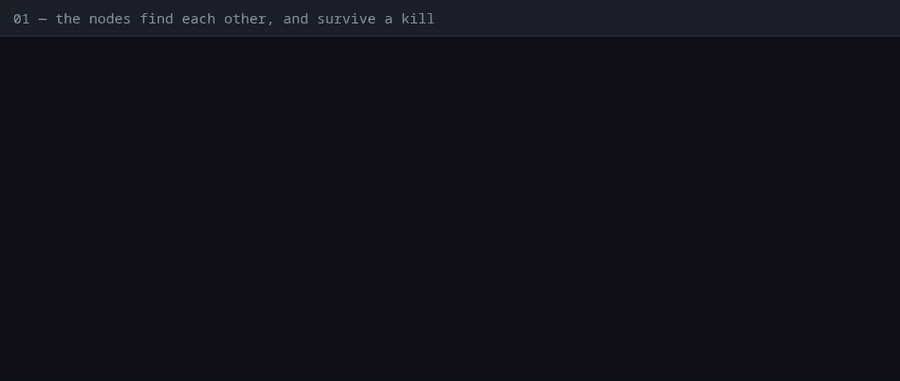
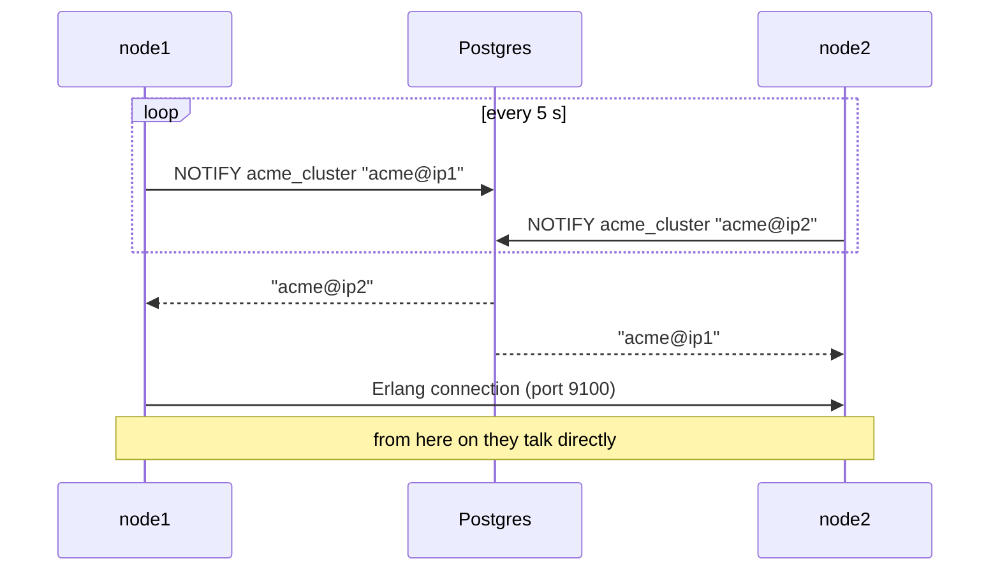

# 01 — The nodes find each other, and survive a kill

Claim: If you start three copies of the same release, they join into one cluster through Postgres alone. You need no Consul, no DNS, and no extra service. If a node is killed without warning, it drops out and the load balancer keeps answering. The node joins again when it comes back.

Library code: `Dandelion.Cluster`, `Dandelion.Cluster.Postgres`.

The [`run.log`](run.log) shows one line for each check, with the time that it happened:

- Each node lists the other two.
- A broadcast on one node reaches a subscriber on another node.
- Six requests through nginx return 200.
- `node2` is killed with `SIGKILL`. Then `node1` sees one other node, and six more requests return 200.
- `node2` starts again, and both sides see each other.

Not shown: real VMs, and a network that silently drops packets (see [LIMITS](../LIMITS.md)). The database outage is [claim 07](../07-database-outage/).

To run it again, run `evidence/record.sh proof`.
