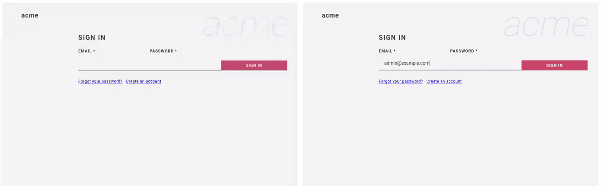

# 02 — An order made on one node shows live in a browser on another

Claim: A message that one node sends reaches browsers that connect to any other node. The "who is online" count includes every connection across the cluster. You do not run Redis or a socket server.

Library code: none, on purpose. This is `Phoenix.PubSub` and a channel in the example app. It runs on the cluster from [claim 01](../01-cluster/). This is the evidence that the cluster carries it.

The page says which node each browser connects to (*connected to acme@…*). The recorder retries until the two browsers are on different nodes. Then it does these steps:

1. Both pages show **2 online now**.
2. The recorder creates an order in browser A. The order appears in browser B within a second.
3. The recorder creates an order in browser B. The order appears in browser A.
4. Browser B closes. Browser A drops to **1 online now**.

The [`run.log`](run.log) names the two nodes and each step. The stills are [`browser-a.png`](browser-a.png) and [`browser-b.png`](browser-b.png).

Not shown: many thousands of connections, and the behavior during a network split. Presence merges when the split heals (see [LIMITS](../LIMITS.md)).

To run it again, run `evidence/record.sh live`.
