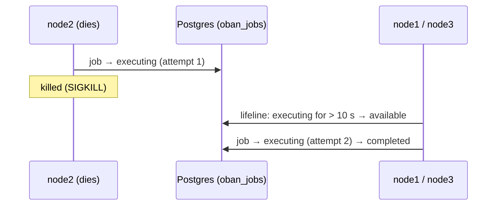

# 03 — A job left by a killed node is run again by another node

Claim: A background job belongs to the cluster and not to a node. If the node that runs the job dies, another node runs it again. A job that is queued runs one time.

Library code: `Dandelion.Queue` (the lifeline configuration), on Oban.

The [`run.log`](run.log) shows these events:

- An order queues its confirmation job. The job completes in 1 attempt on one node.
- A node that dies leaves a job row in the state `executing`. Ten seconds later, another node gives the job back. The job completes on its 2nd attempt.

One detail is important. No job in the example runs long enough to catch it in the middle of its run. The proof therefore writes the `executing` row by hand and then kills the node. It proves that the cluster gives such a job back and runs it. It does not prove the exact moment of a crash. The recovery time is `rescue_after`. It is 10 s in the proof and 5 minutes by default.

Negative control: If the rescue time is a day, the proof fails at the ordered-queue step that depends on it ([`controls/lifeline.log`](../controls/lifeline.log)).

To run it again, run `evidence/record.sh proof`. To run the control, run `evidence/record.sh controls`.
