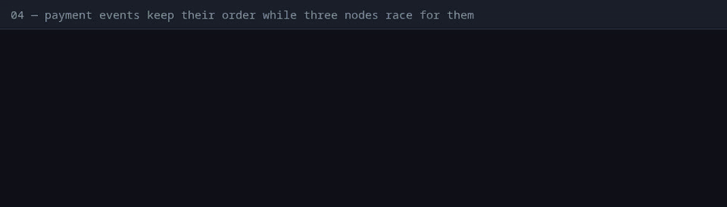
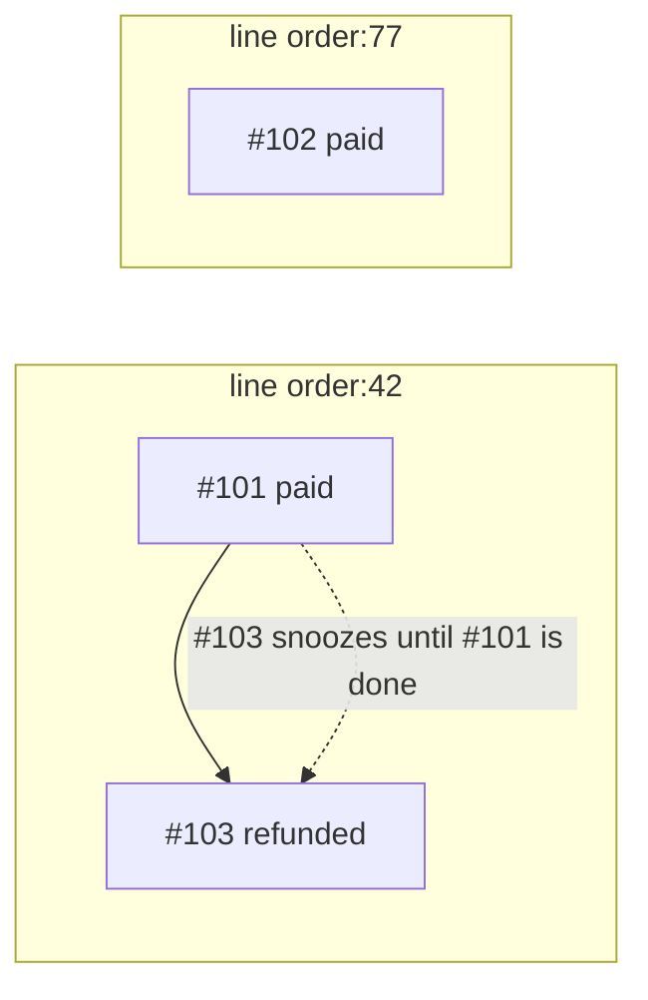

# 04 — Events of one order keep their order, while three nodes race for them

Claim: Each `order.created` subscriber runs one time for each order. The payment events of one order run in the order that they arrived, also when three nodes compete for the jobs. Other orders are not held back. An unfinished event of a dead node holds back only its own order, until the service gives the event back.

Library code: `Dandelion.Queue.Ordered`, `Dandelion.PubSub`.

The [`run.log`](run.log) shows these events:

- Every subscriber of `order.created` completed one time. The proof reads the count from `Platform.PubSub`.
- The webhook refuses a request without the token (401).
- Ten orders each get a payment and then a refund. The proof sends them in that order while the queue is held. Then it releases the queue to all three nodes. A refund that runs before its payment is dropped, because a pending order cannot be refunded. Ten orders that end as `refunded` therefore mean that the order was kept.
- A job that is stuck on a "dead node" blocks only its own order. Another order is paid in the meantime. After the rescue, the refund of the held order runs after the payment.

Negative control (the important one): If we disable the order check, the same proof fails. Some order ends as `paid` and not as `refunded` ([`controls/ordering.log`](../controls/ordering.log)). The proof can tell the difference.

Not shown: the order of events that different servers send at nearly the same instant. Order means arrival at Postgres and not the clocks of the senders.

To run it again, run `evidence/record.sh proof`. To run the control, run `evidence/record.sh controls`.
