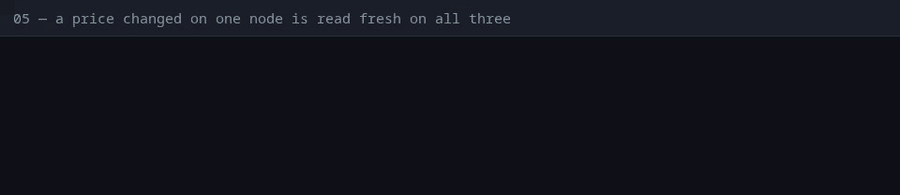
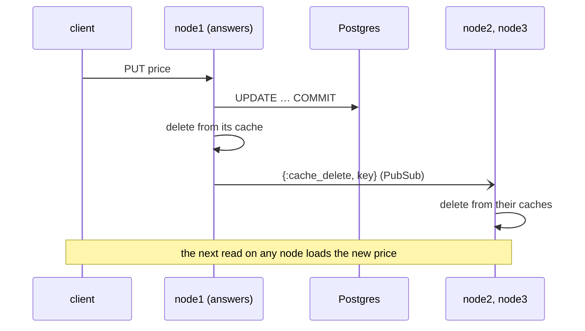

# 05 — A price changed on one node is read fresh on all three

Claim: Every node keeps its own copy of a cached value, so a read costs no network trip. A delete through any node clears the value on all nodes. A node that loses a node and gets it back starts with an empty cache.

Library code: `Dandelion.Cache`, `Dandelion.Cache.Listener`.

The [`run.log`](run.log) shows these events:

- The proof reads a product on all three nodes. Each node keeps its own copy.
- The proof changes the price through nginx. Any node can answer. Then every node reads the new price.
- `node1` drops a node and gets it back. Its cache is empty.

Negative control: If we remove the broadcast, the proof fails at the price check. Two nodes still read the old price ([`controls/cache.log`](../controls/cache.log)).

Not shown: a network split. The halves can drift for up to the 60 s TTL and then converge (see [LIMITS](../LIMITS.md)).

To run it again, run `evidence/record.sh proof`. To run the control, run `evidence/record.sh controls`.
