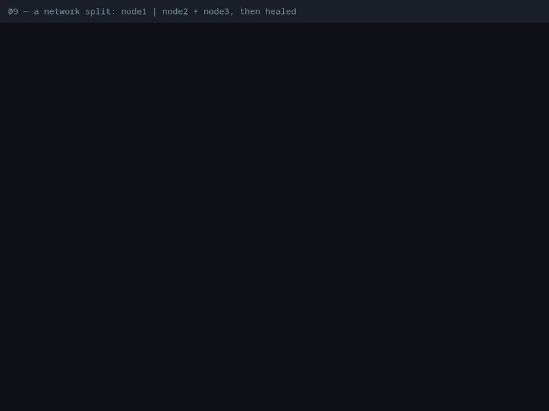
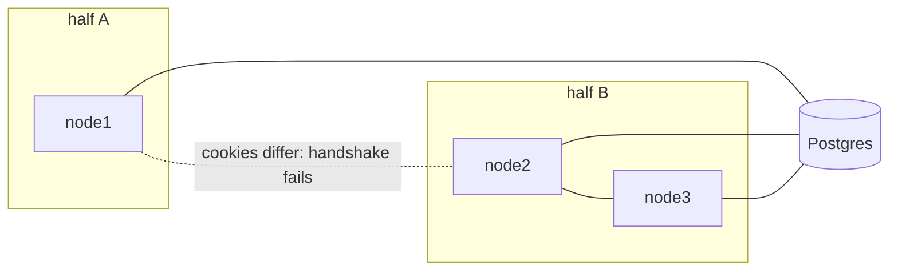

# 09 — A network split: what each half can do, and what happens on the heal

Claim: The cluster splits into two halves that cannot see each other. Both halves can still reach Postgres. In this case, nothing that must be right goes wrong. Jobs, events, and ordered payments still run exactly one time. There is still one cron leader. The pieces that live in memory (broadcasts, caches, and presence) behave as DESIGN §10.3 says. The split loses them or makes them stale for a short time. They correct themselves when the halves meet again.

Library code: `Dandelion.Cache` (the clear on rejoin), `Dandelion.Queue`, `Dandelion.Queue.Ordered`, `Dandelion.PubSub`, `Dandelion.Cluster`.

How we make the split: The proof needs no privileges and no firewall rules. It gives `node1` a wrong Erlang cookie for `node2` and `node3`. It gives those two nodes a different wrong cookie for `node1`. Then each side drops the connection. libcluster tries to reconnect and the handshake fails each time. The heal puts the right cookie back. All three nodes keep their Postgres connection throughout.

The [`run.log`](run.log) shows these events, with times:

| During the split | Because |
|---|---|
| A live broadcast on `node1` does not reach `node2`. | It is fire and forget, like Redis pub/sub. The split loses it. |
| A price that changes on the side of node2 is read at once on node2 and node3. The cut-off `node1` still serves the old price. | A cache belongs to one node. The delete could not reach it. |
| 10 orders made on both sides produce 20 subscriber jobs. Each job completes one time. | The jobs live in Postgres, which both halves reach. |
| Exactly one cron leader exists. | The leader of Oban is a row in Postgres. |
| A payment sent on the side of node1 and its refund on the side of node2 run in that order. | The order check asks Postgres. |
| Each half sees only its own viewers (node1 1, node2 2, node3 2). | Presence is memory. It merges between connected nodes. |

| After the heal | Because |
|---|---|
| The halves find each other again (seconds). | libcluster reconnects when the cookies match. |
| The cache of `node1` is empty. An entry that the node cached just before the heal is gone. It is not only an expired entry. The node reads the current price. | `Dandelion.Cache.Listener` clears on `:nodeup`. |
| Presence is merged. Every node sees all 3 viewers again. | Phoenix.Presence is a CRDT, so it converges. |
| Exactly one cron leader remains. Each payment event completed one time. | Postgres decided throughout. |

Negative control: If we remove the clear on rejoin, the proof fails at "node1's cache was emptied when it rejoined" ([`controls/rejoin.log`](../controls/rejoin.log)).

A flapping split (the last part of the log): The proof makes the same split and heal five times in a row, a few seconds apart. All the while, it sends orders, payments, and refunds through both halves. After the last heal, everything has converged:

- Every node sees the others.
- Presence has merged.
- There is one leader.
- Every order has exactly one completed job for each subscriber (three jobs for each order).
- The five orders that the proof paid and then refunded all end as `refunded` in that order.
- Each of the ten payment events completed one time.

Not shown: a half that Postgres cannot reach (that is [claim 13](../13-database-failures/)), an asymmetric split (A sees B but B cannot see A), and a very long split. In a split longer than the 60 s cache TTL, the stale entry expires by itself. The proof keeps the check independent of that. See [LIMITS](../LIMITS.md).

To run it again, run `evidence/record.sh partition`. To run the control, run `evidence/record.sh controls`.
