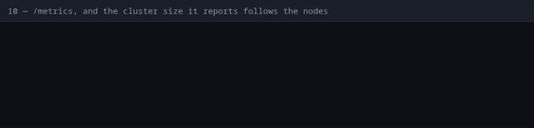

# 10 — `/metrics`, and the cluster size it reports follows the nodes

Claim: Every node serves its own Prometheus metrics at `GET /metrics`. The metrics cover requests, handlers, the database, background jobs, the hits and misses of the cache, and the number of nodes that the node connects to. That last number is a live gauge. It drops when a node is killed and returns when the node joins again. You can therefore alert on it.

Code: `Platform.Web.Telemetry` and `Platform.Web.MetricsHandler` in the example. One function holds the metric list. The reporter is `telemetry_metrics_prometheus_core`. `Dandelion.Cache` emits `[:dandelion, :cache, :fetch]` for the counter of hits and misses.

The [`run.log`](run.log) shows these events, with times:

- `GET /metrics` through nginx returns 200 and Prometheus text with the request histogram.
- Every node reports `platform_cluster_nodes_count 3`.
- `node3` is killed with `SIGKILL`, and the metric of `node1` drops to 2.
- `node3` comes back, and the metric of `node1` is 3 again.

A poller refreshes the gauge every 10 s. The proof therefore allows up to 30 s for each change. A monitoring system sees the change within one or two scrapes.

Not shown:
- A running Prometheus or Grafana. The proof reads the endpoint and the numbers. It does not read a dashboard. ([Claim 23](../23-dashboard/) covers the dashboard.)
- The `METRICS_TOKEN` option. It has unit tests in the example but no cluster check.
- Metric values under load.

To run it again, run `evidence/record.sh proof`.
