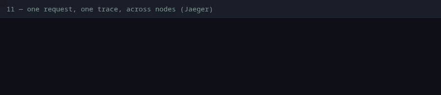
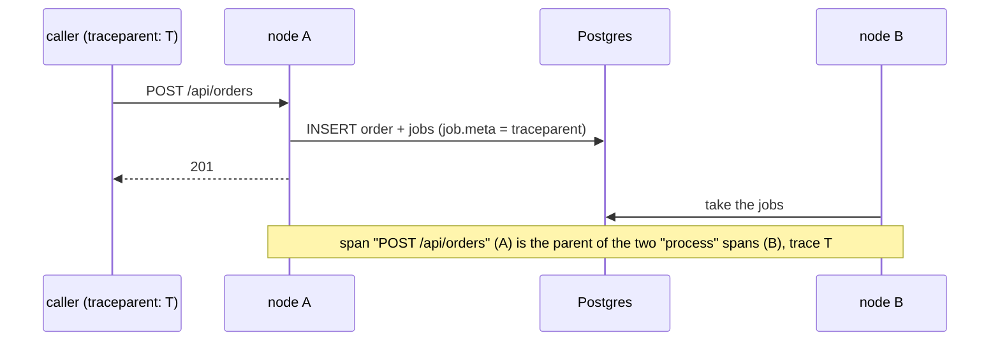
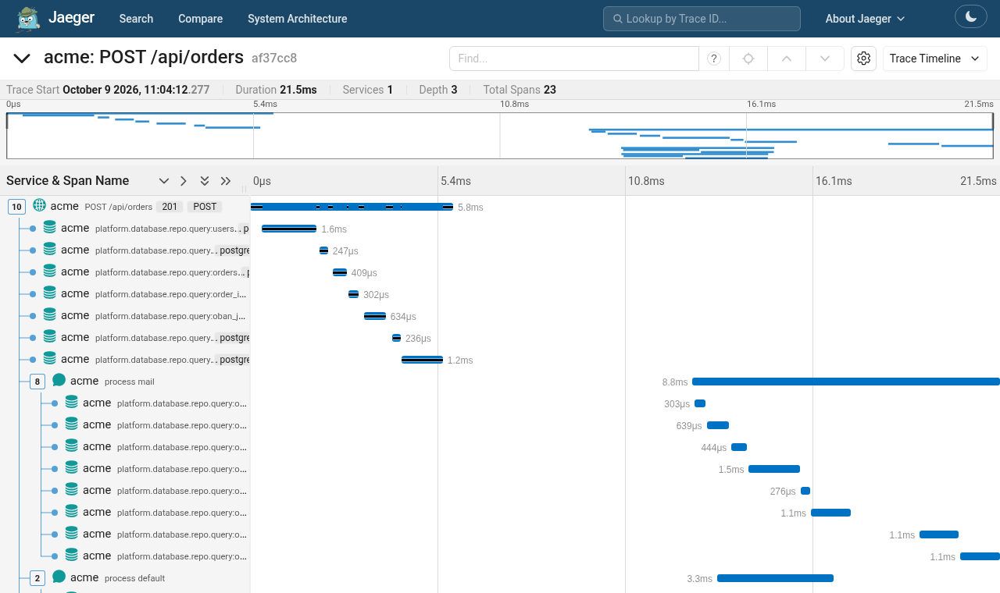

# 11 — One request, one trace, across nodes

Claim: A request is a trace. The work that it causes (its database queries and the background jobs that it queues) belongs to the same trace. This is true also when the job runs on a different node. A trace id that the caller sends is kept.

Code: the tracing setup of the example (`Platform.Application`, `config/runtime.exs`, `rel/env.sh.eex`). In the library, `Dandelion.PubSub` and `Dandelion.Queue.Ordered` store the trace context in the job (`Dandelion.Trace`).

The [`run.log`](run.log) shows these events, with times:

- `GET /health` with our own `traceparent` is that trace in Jaeger a few seconds later. The proof queries Jaeger over its API. The trace is made on the node that took the request.
- An order sent in the same way has database spans for the order (`…repo.query:orders`).
- One trace has two nodes. The request is on one node, and the two jobs of the order (the confirmation and the customer statistics) are on another node. The proof makes up to ten orders until a job lands on a different node than the request. Usually the first order does this.

The picture below shows the UI of Jaeger with the trace of an order. The proof found the trace through the search of Jaeger. After a warm-up, [`browser/jaeger-ui.mjs`](../browser/jaeger-ui.mjs) takes the picture from a trace whose jobs ran on another node than the request.

Not shown:
- A backend other than Jaeger. The spans are standard OTLP, so Tempo or Honeycomb must work, but we did not test them.
- Sampling. The proof keeps every span. The README says to sample in production.
- The trace propagation of the ordered queue. A unit test covers it in the library. The cluster proof does not.

To run it again, run `evidence/record.sh proof`. You need python3 to read the JSON of Jaeger.
