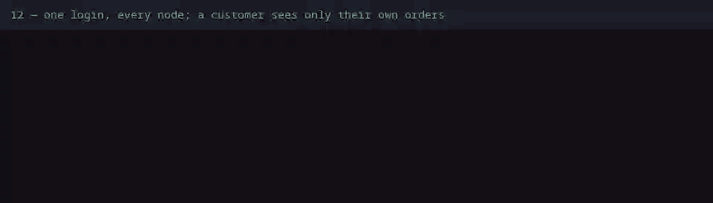

# 12 — One login, every node; a customer sees only their own orders

Claim: A login is a signed token that every node accepts. There is no session to share. Routes need the token. A customer sees and cancels only their own orders. For the orders of other people, the customer gets a 404. Only admins change prices. The service refuses a tampered token and a WebSocket without a token.

Code: the `accounts` domain of the example and the pipelines of the router. This code is not in the library, because auth belongs to the app. The cluster is the reason that the first claim is worth testing.

The [`run.log`](run.log) shows these events, with times:

- An order without a login gets 401.
- The proof logs in one time and sends nine requests. nginx spreads them over the nodes and says which node answered. All three nodes accept the same token.
- A customer reads and cancels their own order. The customer gets 404 for the order of an admin. This is the same answer as for an id that does not exist. The list of the customer holds only their own orders. The admin sees both.
- A customer who changes a price gets 403.
- A token with one added character gets 401.
- The WebSocket gets 403 without a token or with a bad token. It gets 101 with a good token.

Not shown:
- That a token expires. A unit test covers this: an expired token, a forged token, and a token for another purpose each get 401.
- The strength of the password hashing. A unit test checks the format and the verification. It does not check that 600 000 iterations are enough for you.
- Protection against brute force. The load balancer does this work. ([Claim 14](../14-reliability/) covers the rate limit in the app.)
- That a stolen token is valid until it expires. There is no revocation.

To run it again, run `evidence/record.sh proof`.
