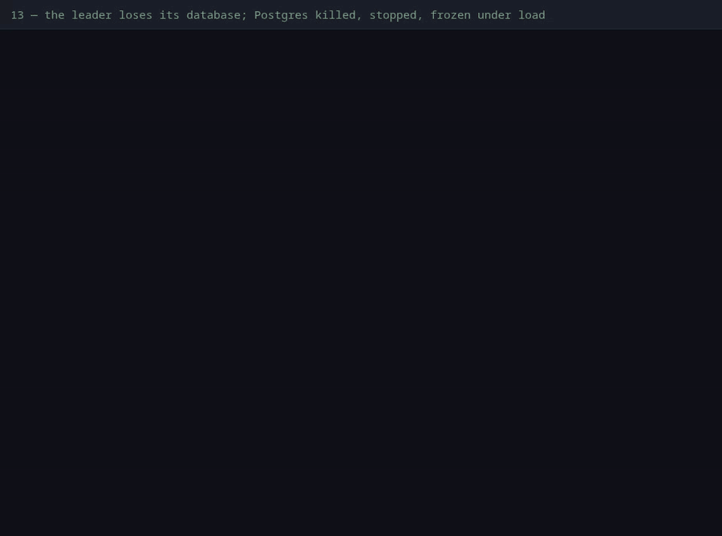

# 13 — The leader loses its database; Postgres is killed under load

Claim: Two harder database failures do not break what the cluster promises.

1. The leader cannot reach Postgres. Only the leader is cut off, and it is not cut off from the cluster. The leader stops jobs and steps down. Another node takes over as the only leader. The other nodes continue to work. The cache of the cut node serves until the entries expire and not one second longer. When its database returns, the node is whole again.
2. Postgres goes away under load. It is killed, stopped cleanly, or frozen. During this, three clients make orders through the load balancer. Every order that got 201 is still there afterwards. Every order has all its events. There is never an order without events and never an event twice. No node restarted.

Code: nothing new in the library. The proof uses the leader election of Oban, the expiry of `Dandelion.Cache`, and `Dandelion.PubSub.publish/3` inside the transaction of the order. The last one makes the last claim true.

How we make the cut: Postgres sits on its own Docker network (`db`). The nodes are on that network and on `default`, where they find each other. To cut one node off, the proof runs `docker network disconnect`. It needs no privileges and no firewall rules. The nodes take their names from their address on `default` (`NODE_HOST`). The other nodes can therefore still reach the cut node.

The [`run.log`](run.log) shows these events, with times:

| Leader cut off | Because |
|---|---|
| The leader cannot reach Postgres, and the others can. All three nodes still see each other. | The networks are separate. |
| The leader still serves a cached price. | `Dandelion.Cache` serves it from memory. |
| 6 orders on the other nodes: all 12 subscriber jobs complete one time. None runs on the cut node. | The cut node cannot claim jobs. |
| The leader steps down, and another node becomes the only leader. This took 37 to 53 s after the cut in the runs. Two leaders never existed at once. The proof sampled throughout. | The lease of Oban in Postgres expires. |
| After 70 s, the cached price is gone and the node cannot answer. | A cache does not replace the database. |
| After the reconnect, the node reaches Postgres at once. There is still one leader. The node sees all the orders and takes jobs again. | Postgrex reconnects by itself. |

Postgres goes away under load in three ways. In the first way, the proof kills it (SIGKILL, a crash). In the second way, it stops it cleanly. In the third way, it freezes it. A frozen process keeps its connections open, but nothing answers. A hung or overloaded database looks like this. Three clients make orders through the load balancer the whole time. The same promises hold each time:

| After each outage | Because |
|---|---|
| A few hundred orders got 201 (251, 280, and 282 in the recorded run). Some orders failed during the outage. | The outage was real. |
| Every acknowledged order is in the database afterwards. | The write-ahead log of Postgres. |
| Every order in the database has exactly one completed job for each subscriber. There are three subscribers now: confirmation, customer statistics, and webhook fan-out. The service discarded none. | The order and its events are one transaction. |
| No node restarted. There are 3 nodes, `/health` answers 200, and exactly one cron leader exists again. | The pool and the cluster reconnect. |

While the database is frozen, the proof also checks what a client and a load balancer see. `/health` answers 503 in a few seconds (3.8 s in the recorded run), because a request must give up on its stuck connection. The API answers 503. It does not answer 500 and does not hang. This test found both problems. The first `/health` during a freeze hung for 32 seconds, and a hung database gave a 500.

Negative control ([`controls/dualwrite.log`](../controls/dualwrite.log)): If the service saves the events after the transaction of the order, the same proof fails. The gap is long, so a crash always falls into it. Orders then exist without their events. This is the dual-write problem. The project avoids it when it publishes inside the transaction.

Not shown:
- An outage of minutes. The longest outage is about 25 s.
- A cut that drops only some connections.
- A leader that is cut off from the cluster but not from Postgres. That is claim 09.
- An asymmetric split.
- A database that is slow and not gone.

To run it again, run `evidence/record.sh failures`. To run the control, run `evidence/record.sh controls`.
