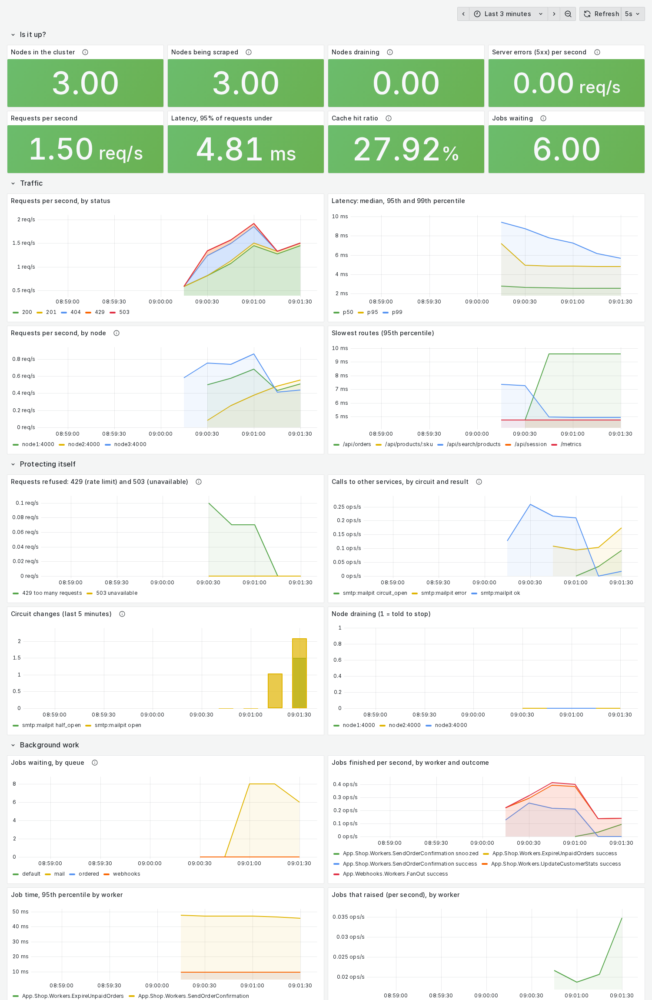

# 23 — A dashboard, checked against what it is for

**Claim.** The dashboard (`deploy/grafana/dashboards/dandelion.json`, loaded by Grafana from a
file) shows what is happening, and every number on it is real:

1. **The pieces work.** Prometheus reads `/metrics` from all three nodes; Grafana has the
   dashboard (25 panels, provisioned read-only from the file) and reaches Prometheus.
2. **Things are made to happen**, each of which a panel is for: 30 orders, searches and unknown
   products (traffic, 404s); a client over its rate limit (**21 requests answered 429**); orders
   paused by a flag (**6 answered 503**); the mail server stopped (**8 mail jobs waiting, and a
   circuit opened**, counted); a node told to stop (**seen draining**).
3. **Every query of the dashboard runs without error** (30 of them), **and the 16 panels that
   show those things have data** — requests by status, latency, requests per node, slowest routes,
   calls to other services by circuit, circuit changes, jobs waiting by queue, jobs and their
   time, the database wait, cache fetches, memory, scheduler load, draining.

*(the screenshot is taken by [`render/shot.mjs`](../render/shot.mjs) right after the proof, from
Grafana's kiosk view, last 3 minutes.)*

**Code:** the dashboard JSON, `prometheus.yml` and the Grafana provisioning files in
`example/deploy/`; the metrics in `Platform.Web.Telemetry` (new: calls and circuit changes by
circuit, queue depth by queue and state, draining). DESIGN.md §10.21.

**Negative controls** ([`badpanel.log`](../controls/badpanel.log),
[`nocircuitmetric.log`](../controls/nocircuitmetric.log)): a typo in a panel's metric name runs and
returns nothing, so the proof stops at "the panels … have data"; a circuit that opens but is not
counted stops the proof at "the mail server stopped", because the dashboard could not have said so.

**Found by running it:**
- Prometheus was refused at `/metrics` — the production `force_ssl` redirected its plain-http
  scrape to https; `/metrics` is now excluded like `/health`.
- The queue-depth panel was empty when idle: a metric made only from rows that exist has no
  series for an empty queue. Every queue and state is now reported, zero when empty.
- The "draining" panel never showed a drain: a gauge set by a 10 s poll cannot see a 5 s drain.
  It is now set when draining starts.

**Not shown:** alerting; a long run (the screenshot is a minute of events on a fresh cluster);
that the thresholds are the right ones for any real service. See [LIMITS.md](../LIMITS.md).

**Re-run:** `evidence/record.sh dashboard` (about 2 minutes; Playwright for the screenshot);
controls: `ONLY=badpanel evidence/record.sh controls`, `ONLY=nocircuitmetric …`.
