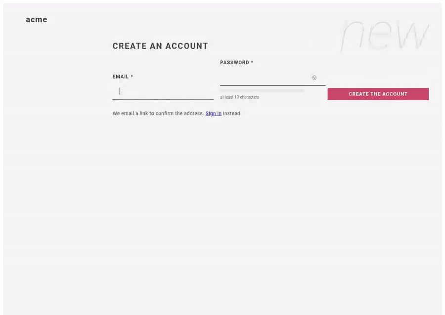

# 26 — The console, in a real browser

**Claim.** The Vue console does what the service does, and a person can use it: a real Chromium drives it
against the 3-node cluster, from a new account to a phone-sized screen, and every step below is a line of
[`run.log`](run.log) that had to be true.

1. **A new customer.** Create an account (it signs in and says the address is not confirmed); open the
   link from the email — it opens the console, confirms the address, and the warning goes; a customer sees
   Products and Files and not the staff pages, and a staff page opened by hand says it is for staff.
2. **A forgotten password.** Asking shows the same words for any address; the link's page refuses a
   password that is too short (saying why) and two that differ; a good one is accepted; **the same link a
   second time is refused**; the old password no longer signs in and the new one does.
3. **Guessing.** Five wrong passwords lock the address; even the right one is refused, and the page says
   for how long (15 minutes).
4. **Staff.** An order made in the form appears in the live list. **Products:** typing "gre" finds
   "Green tea" with no button pressed; a typo is forgiven and the page says the names are only close; typing
   fast shows the answer for what was typed last; a product just added is found at once, its description
   word is highlighted, and **a name with HTML in it shows as the characters typed — nothing becomes markup**;
   a rename is found by the new name, a removal is gone from the next search. **Settings:** the switch pauses
   new orders and the order form then says so; the switch opens them again. **Audit log:** shows the switch
   and the product and who did them, and filters to settings. **Webhooks:** an endpoint is added and its
   signing secret shown once — a reload does not show it. **Files:** a 2 MB file is uploaded and listed
   with its type, downloaded as **the very same bytes**, a program named `.png` is refused (the bytes
   decide), a file is removed.
5. **A phone.** At 390 px wide, none of the six pages is wider than the screen.

Screenshots of each page: [`orders`](orders.png), [`products`](products.png), [`settings`](settings.png),
[`audit`](audit.png), [`webhooks`](webhooks.png), [`files`](files.png), and the account pages
([`register`](register.png), [`unconfirmed`](unconfirmed.png), [`forgot`](forgot.png), [`reset`](reset.png),
[`locked`](locked.png)); [`phone`](phone.png).

**Code:** `example/assets/src/` — `App.vue`, `pages/*.vue`, `api.ts`, `router.ts`, `highlight.ts` (with
`highlight.test.ts`, run by `npm test`). DESIGN.md §10.24.

**Negative controls** ([`xss.log`](../controls/xss.log), [`leakyorders.log`](../controls/leakyorders.log)): a
product name put on the page with `v-html` becomes markup (the `<i>` is italic) and the proof stops;
without the `v-show` that hides it, the orders list stays on top of every other page and the proof stops.

**Found by running it** — each of these was a bug in the first version of the console, found by the browser
and by looking at its screenshots, and fixed:
- the orders page is a fragment (two sections), and `v-show` cannot hide a fragment: **the orders list showed
  on every page**;
- a confirm dialog that is not told to close **stays open over the page** after "Remove";
- a settings switch showed "on" before the settings had loaded;
- nginx refused any body over 1 MB, so **the app's 5 MB file limit could not be reached** through the load
  balancer (and the uploads proof's "7.5 MB is refused" was nginx's answer, not the app's — it now also tests
  6.1 MB, which only the app can refuse);
- a 503 showed as "HTTP 503"; it says the service is busy.

**Not shown:** other browsers, assistive technology, slow networks, the emailed pages in a real mail client
(see [LIMITS.md](../LIMITS.md)).

**Re-run:** `PLAYWRIGHT=… evidence/record.sh console` (about 2 minutes; Playwright and ffmpeg);
controls: `ONLY=xss evidence/record.sh controls`, `ONLY=leakyorders …`.
